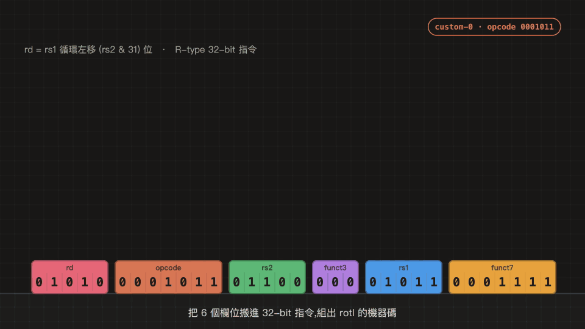

# rotl:`instructions/15_ROTL/` 的獨立副本

| 項目 | 內容 |
|---|---|
| 指令名稱 | `ROTL` |
| 題目類別 | 密碼學 / 雜湊類 |
| 運算元類型 | 二元 |
| 輸入定義 | rs2 低 5 位元為移位量 n |
| 語意公式 | `rd = (rs1 << n) \| (rs1 >> (32 − n)),n = 0 時 rd = rs1` |

正式語意與測試向量見 [HOMEWORK.md 第六節](https://github.com/DevSecOpsLab-CSIE-NPU/2026-Computer-Architecture/blob/main/HOMEWORK.md#六題目語意規格)。



```
rotl rd, rs1, rs2      n = rs2 & 31;  rd = n == 0 ? rs1 : (rs1 << n) | (rs1 >> (32 − n))
```

R-type,custom-0(`0001011`)。funct3 / funct7 **待教師分配**,目前為暫定值(見 [`spec/rotl_isa.h`](spec/rotl_isa.h))。

> 本 repo 是組長 repo [yuchi-create/2026-Computer-Architecture](https://github.com/yuchi-create/2026-Computer-Architecture/tree/main/instructions/15_ROTL) 中 `instructions/15_ROTL/` 的獨立副本,**內容以組長 repo 為準**,兩邊只差這幾行說明與路徑。另外放一份是因為桌寵 demo 要「跳到桌面拿資料夾」,專案資料夾必須直接放在桌面上(見 `demo/osbridge.py` 的 `finder_icon_pos`)。CP1 已於 2026-10-13 在本 repo 打 tag [`cp1-submit`](https://github.com/Underiger/rotl/releases/tag/cp1-submit)。

## 小組資訊

| 項目 | 內容 |
|---|---|
| 組名 | ROTL |
| 組長 | 解昱齊(1114405055) |
| 組員 | 張宇憲(1114405004)、洪翊滕(1114405019)、解昱齊(1114405055)、尤靖暘(1114405056) |
| 分支 | `dev/<學號>`(各組員自行填寫) |

## 目錄結構

```
rotl/
├── README.md                 本檔
├── CONTRIBUTIONS.md          個人貢獻聲明
├── Makefile                  在本目錄執行 make test 等指令
├── c_baseline/               CP1:C 參考實作與測試
├── tests/                    16 組測資 CSV
├── rv32im/                   CP2–CP3:RV32IM 組合語言、密碼學核心
├── spec/                     CP3:語意規格、編碼;rotl_isa.h 是編碼常數的唯一設定來源
├── references/               參考資料
├── tools/                    黃金模型、RV32IM 模擬器、量測腳本、Python 測試
├── experiments/              效能驗證:IC 交叉驗證、5 級 pipeline 模型、ARM64 實機量測
├── demo/                     簡報 Demo:Claude 吉祥物桌寵、動畫影片(media/)
└── report/
    ├── CP1.md  CP2.md  CP3.md
    └── figures/              make counts 產生的數據表
```

以下指令都在 repo 根目錄執行。

## 執行方式

需要:`cc`(主機 C 編譯器)、`python3`(3.10 以上)、`riscv64-elf-gcc`。

```bash
make test      # C 測試 + UBSan + 22 項 Python 測試(含模擬器)
make counts    # 重新量測指令數,寫入 report/figures/
make encode    # 印出 rotl 的機器碼範例
make asm       # 產生編譯器輸出的組合語言 build/rotl_O0.s、build/rotl_O2.s
make ub-demo   # 反例:未處理 n = 0 的寫法(預期報錯)
make verify    # 效能驗證(見 experiments/README.md;ARM64 實機量測只在 ARM64 電腦執行)
make pet       # 簡報 Demo:Claude 吉祥物桌寵(見 demo/README.md,需要 macOS,會自動安裝 PyQt6 到 .venv)
make media     # 重新輸出 demo/media/ 的動畫影片(需要 ffmpeg)
```

## 目前結果

- C 參考實作:16 組測資、69,000 次交叉比對、UBSan 全部通過
- RV32IM:手寫無分支版 4 條指令(不含 `ret`),GCC `-O2` 為 5 條,自訂指令 1 條
- 動態指令數(模擬器實測,GCC 16.2.0 `-O2`):

| 核心 | RV32IM | ROTL | IC 比 |
|---|---:|---:|---:|
| ChaCha20 區塊 | 1919 | 1284 | 1.49x |
| RC5 金鑰排程 | 2467 | 2000 | 1.23x |
| RC5 加密一個區塊 | 227 | 131 | 1.73x |

- 效能驗證([`experiments/`](experiments/README.md)):IC 以反組譯手算交叉驗證一致;5 級 pipeline 模型的 cycle 比 1.21x–1.67x;ARM64 實機用旋轉指令 `ror` 快 1.29x–1.52x(旁證)。前提是 ROTL 不拉長 clock period,待 CP4 確認

## Git 規則(HOMEWORK.md 5.1)

- 每位組員在 `dev/<學號>` 分支開發,不直接推送到 `main`
- Checkpoint 截止前由組長開 PR 合併到 `main`,並打 tag:`cp1-submit`、`cp2-submit`、`cp3-submit`
