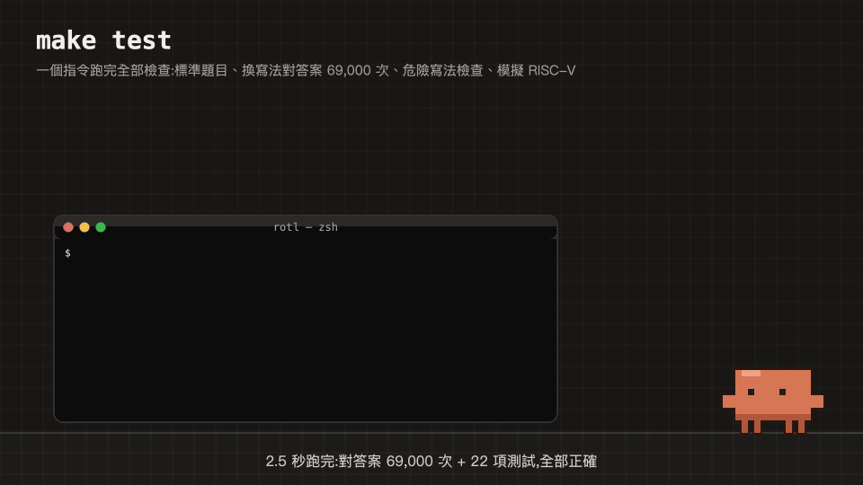

# demo/:Claude 吉祥物桌寵

簡報現場 Demo 用。Clawd(Claude 的像素吉祥物)會跳到桌面上 `rotl` 資料夾的圖示把它拿下來、打開,再依序抽出三個檔案展示:

| 步驟 | 抽出的檔案 | 畫面 | 背後的系統操作 |
|---|---|---|---|
| ① 編碼組裝 | `src/include/rotl_isa.h` | 搬運 funct7 / rs2 / rs1 / funct3 / rd / opcode 方塊,組成 `0x1EC5850B` | 編碼來自 `tools/rotl_isa.py`;`riscv64-elf-objdump` 反組譯 `build/kernels_custom.elf`,找出實際編譯出來的 rotl 機器碼 |
| ② M5 晶片實測 | `experiments/arm64_rotate_bench.c` | 高舉發光晶片,跳出加速比標籤 | `sysctl` 讀晶片、核心叢集、快取、分頁大小;`cc` 編譯後在本機現場執行 benchmark |
| ③ make test | `Makefile` | 爬上終端機視窗,全數通過時頭頂跳出 All Passed! | AppleScript 開 Terminal、讀視窗位置與輸出;`ps` 偵測測試行程 |



## 安裝與執行

需要 macOS(AppleScript、`sysctl`)與 Python 3.10 以上。

```bash
python3 -m venv .venv
.venv/bin/pip install -r demo/requirements.txt
make pet          # 等同 .venv/bin/python demo/pet.py
```

`make pet` 第一次執行時會自動建立 `.venv` 並安裝 PyQt6。題目允許 PyQt6 或 tkinter,本組用 PyQt6:透明、滑鼠可穿透、永遠在最上層的視窗需要 Qt,而且 Homebrew 的 Python 3.14 預設沒有 `_tkinter`。

第一次執行時 macOS 會詢問是否允許控制 Finder 與 Terminal,請按「好」。按錯的話到「系統設定 → 隱私權與安全性 → 自動化」打開。

| 參數 | 用途 |
|---|---|
| `--tour` | 啟動後直接開始導覽 |
| `--auto` | 導覽自動播放,不用點擊(排練用) |
| `--scale N` | 吉祥物大小(預設 6,投影機可用 8) |
| `--no-watch` | 不偵測終端機的測試指令 |

## 操作

| 動作 | 效果 |
|---|---|
| 雙擊吉祥物 | 開始導覽:拿資料夾 → ① → ② → ③ → 把資料夾放回桌面 |
| 點吉祥物 | 導覽中:下一步;動畫播放中:快轉;平常:講一個專案小知識 |
| 拖曳 | 把吉祥物抓起來丟到別處 |
| 右鍵,或選單列的吉祥物圖示 | 選單:單獨播放 ①②③、硬體資訊、在 Finder 打開、開關終端機偵測;關閉要選「結束桌寵 → 確定結束」(兩步,避免誤按) |

## 現場 Demo:在終端機打指令

桌寵開著時,在 Terminal.app 自己輸入:

```bash
make test
```

桌寵每秒用 `ps` 檢查一次行程,看到 `make test`、`test_rotl`、`unittest discover` 等指令,就用行程的 tty 找出是哪一個 Terminal 分頁在跑、走過去爬上那個視窗,一邊讀分頁的輸出一邊打勾,全部通過後頭頂跳出 All Passed!。iTerm2 改看最前面的視窗;其他終端機讀不到輸出,吉祥物只會在地上等。

注意:`tools/rv32sim.py` 只是模擬器模組,沒有主程式,直接執行 `python3 tools/rv32sim.py` 不會跑任何測試。69,000 次交叉比對是 `make test` 裡的 C 測試(`src/c_baseline/test_rotl.c`),模擬器的 22 項測試在 `make test-py`。現場請打 `make test`,兩者都會跑到。

## 影片(README 與簡報用)

```bash
make media        # 等同 .venv/bin/python demo/render_media.py
```

| 檔案 | 內容 | 長度 |
|---|---|---:|
| `media/rotl_encode.{mp4,gif}` | ① 編碼組裝(README 頂部) | 18.7 s |
| `media/m5_speedup.{mp4,gif}` | ② M5 晶片實測 | 11.5 s |
| `media/make_test_all_passed.{mp4,gif}` | ③ make test,現場 Demo 出狀況時的備案 | 11 s |

MP4 為 1920 x 1080、30 fps;GIF 為 960 x 540、15 fps。需要 `ffmpeg`。

影片中的加速比用 [`experiments/README.md`](../experiments/README.md) 記錄的那一次執行(ChaCha20 1.51x、RC5 加密 1.32x),每次輸出都一樣;加 `--live` 改用這台電腦現場量的數字。桌寵的 ② 一律現場量測,數字每次會有些微差異;桌寵動畫和 benchmark 同時在跑,也可能比單獨執行時略低。

## 檔案

| 檔案 | 用途 |
|---|---|
| `pet.py` | 桌寵主程式:全螢幕透明圖層、點擊範圍視窗、導覽腳本、終端機監看 |
| `scenes.py` | 有時間軸的動畫場景(編碼、晶片、終端機、資料夾),桌寵與影片共用 |
| `sprites.py` | 像素吉祥物與道具(資料夾、檔案、晶片、對話框、標籤、彩帶) |
| `osbridge.py` | 所有系統操作:AppleScript、`sysctl`、`ps`、`objdump`、benchmark,以及用 ctypes 呼叫 Objective-C runtime 讓視窗浮在所有桌面空間上 |
| `render_media.py` | 把場景輸出成 MP4 / GIF |
| `run_tests.sh` | ③ 開的 Terminal 執行的腳本:`make test` 並把輸出存到 `build/pet_demo.log` |

限制:只支援 macOS 的主螢幕;吉祥物只會出現在主螢幕上。
